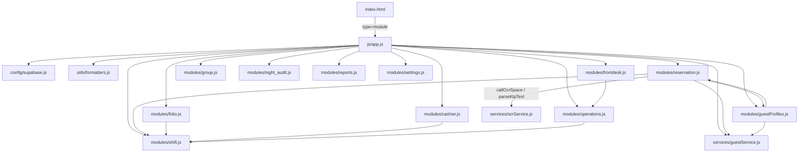
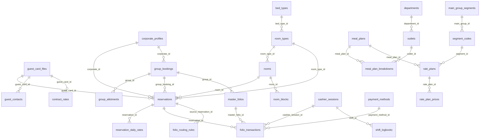

# TECH SPEC — Arsitektur, Struktur Folder, dan Skema Supabase

| Item | Nilai |
| --- | --- |
| Versi | 2.0 |
| Tanggal | 2026-11-26 |
| Commit acuan | `e0f800e` |
| Dokumen terkait | `docs/PRD.md`, `docs/AUDIT_REPORT.md`, `AGENTS.md` |

> **Peringatan validitas skema.** Tidak ada akses langsung ke Supabase pada sesi audit. Seluruh nama tabel dan kolom di §5 **diinferensi** dari `supabase.from()`, `select()`, payload `insert/update/upsert`, nama parameter RPC, serta dokumen lama. Kolom yang tidak dapat dipastikan ditandai *(asumsi)* atau *(fallback alias)*.

---

## 1. Tech Stack

| Lapisan | Teknologi | Catatan |
| --- | --- | --- |
| Markup | HTML5, satu file `index.html` (4.306 baris) | Semua view & modal ada di file ini |
| Styling | Tailwind CSS via CDN (`cdn.tailwindcss.com`) | Konfigurasi inline: `primary = #0064D2`; utility class langsung di markup |
| Ikon | Phosphor Icons via CDN (`unpkg.com/@phosphor-icons/web`) | `<i class="ph ph-*">` |
| Bahasa | Vanilla JavaScript ES6 Modules (`type="module"`) | Tanpa TypeScript, tanpa transpiler |
| Backend SDK | `@supabase/supabase-js@2` via CDN | Client dibuat di `js/config/supabase.js` |
| Database | Supabase (PostgreSQL + PostgREST) | Akses via PostgREST dan RPC (stored procedure) |
| Storage | Supabase Storage bucket `guest_documents` | Public URL untuk dokumen identitas |
| Build | **Tidak ada** (zero-build) | Tidak ada `package.json`, bundler, atau `npm build` |
| Hosting | Static hosting (mis. Vercel / `python -m http.server`) | Cukup serve file statis |
| Testing | `test_guest_lifecycle.py` (Playwright, E2E) | Butuh server lokal + Supabase live |

**Konsekuensi arsitektural:** semua logika berjalan di browser. Tidak ada server aplikasi sendiri; keamanan bergantung pada RLS Supabase dan pada disiplin kode klien.

---

## 2. Struktur Folder

```
NG-Hotel-Management/
├── index.html                  # SPA shell: 11 view + 37 modal + inline config Tailwind
├── js/
│   ├── app.js                  # Entry point: bootstrap, view switching, window bindings
│   ├── config/
│   │   └── supabase.js         # Inisialisasi client Supabase (+ window.supabaseClient)
│   ├── utils/
│   │   └── formatters.js       # Tanggal, currency, badge status, toast
│   ├── services/               # Lapisan API/bisnis yang dipisah dari UI
│   │   ├── guestService.js     # GCF: search (RPC + fallback), get, save, apply to form
│   │   └── ocrService.js       # OCR.space + parser KTP (dipakai reservation.js)
│   └── modules/                # Fitur per domain
│       ├── frontdesk.js        # Dashboard, DataGrid, Tape Chart, Forecast, realtime
│       ├── reservation.js      # Modal reservasi, OCR, dokumen, deposit, check-in
│       ├── group.js            # Group booking, allotment, rooming list, split
│       ├── folio.js            # Folio pribadi/master, transaksi, transfer, checkout
│       ├── cashier.js          # Sesi kasir, blind drop, over/short, laporan shift
│       ├── shift.js            # Open/close shift, logbook, localStorage sesi
│       ├── night_audit.js      # Pre-audit, eksekusi audit, EOD report, riwayat
│       ├── reports.js          # Daily financial report, DRR
│       ├── operations.js       # Housekeeping, blok kamar, NSG, corporate, cancel
│       ├── guestProfiles.js    # GCF master: list, editor, kontak, rate, merge
│       └── settings.js         # 10 tab konfigurasi properti
├── docs/
│   ├── PRD.md                  # (canonical) Product requirements
│   ├── TECH_SPEC.md            # (canonical) Dokumen ini
│   ├── AUDIT_REPORT.md         # (canonical) Hasil audit
│   ├── PRD_HOTEL_PMS.md        # Legacy (superseded)
│   ├── TECH_SPEC_SUPABASE.md   # Legacy (superseded)
│   ├── dokumentasi.md          # Legacy (superseded)
│   └── ai/                     # Catatan memori AI (gemini-memory.json, qwen-memory.json)
├── test_guest_lifecycle.py     # E2E Playwright
├── server.log                  # Log server statis lokal (artefak)
└── *.png                       # Screenshot verifikasi (artefak, ±11 MB)
```

### 2.1 Tanggung jawab file

| File | LOC | Tanggung jawab | Tabel yang disentuh | RPC |
| --- | ---: | --- | --- | --- |
| `js/app.js` | 1218 | Bootstrap, `initApp`, `getHotelBusinessDate`, `switchView`, `toggleMobileSidebar`, `toggleFrontdeskAccordion`, drag-select global listener, day-change detector, binding semua export ke `window` | `properties`, `system_settings` | — |
| `js/config/supabase.js` | 9 | `createClient(SUPABASE_URL, SUPABASE_KEY)`; expose `window.supabaseClient` | — | — |
| `js/utils/formatters.js` | 119 | `formatDateISO`, `addDays`, `parseSafeDateOnly`, `formatStayDatesCompact`, `formatCurrency`, `formatRupiah`, `getStatusBadgeHTML`, `showToast` | — | — |
| `js/modules/frontdesk.js` | 1323 | Dashboard 4 tab, DataGrid, tape chart 14 hari, forecast 14 hari, filter, search, drag, realtime | `reservations`, `group_bookings`, `guest_card_files`, `rooms`, `room_types`, `room_blocks` | — |
| `js/modules/reservation.js` | 3552 | Modal reservasi (2 tab, 4 kartu), GCF autofill, webcam, upload dokumen, OCR, daily rates, deposit, check-in, cancel, reg card, group split, rooming list, routing | `reservations`, `reservation_daily_rates`, `guest_card_files`, `guest_documents` (storage), `group_bookings`, `master_folios`, `folio_transactions`, `folio_routing_rules`, `invoice_settings`, `meal_plans`, `payment_methods`, `rate_plans`, `rate_plan_prices`, `room_types`, `rooms`, `segment_codes`, `corporate_profiles` | `rpc_get_available_physical_rooms`, `rpc_split_group_reservation` |
| `js/modules/group.js` | 977 | Group booking + allotment, edit/cancel, rooming list, split modal | `group_bookings`, `group_allotments`, `reservations`, `master_folios`, `folio_transactions`, `room_blocks`, `rooms`, `room_types`, `guest_card_files`, `corporate_profiles` | `rpc_split_group_reservation` |
| `js/modules/folio.js` | 2828 | Folio pribadi & master, charge/payment/paid-out, void, transfer, routing, checkout, print | `reservations`, `folio_transactions`, `master_folios`, `folio_routing_rules`, `extra_charges`, `payment_methods`, `group_bookings`, `rooms` | `rpc_post_folio_transaction`, `rpc_transfer_folio_transaction`, `rpc_transfer_folio_transactions`, `rpc_void_folio_transaction`, `rpc_process_checkout` |
| `js/modules/cashier.js` | 803 | Sesi kasir aktif/terakhir, tampilan laporan, open/close state, denomination, over/short | `cashier_sessions`, `folio_transactions` | — |
| `js/modules/shift.js` | 554 | Sesi shift + localStorage, open/close shift, ringkasan, logbook | `cashier_sessions`, `shift_logbooks` | `rpc_open_cashier_shift`, `rpc_close_cashier_shift` |
| `js/modules/night_audit.js` | 860 | Pre-audit checklist, konfirmasi, eksekusi, EOD report, riwayat, rekonsiliasi kasir | `cashier_sessions`, `folio_transactions`, `night_audit_history` | `fn_pre_night_audit_check`, `fn_execute_night_audit` |
| `js/modules/reports.js` | 472 | Daily financial report (modal + cetak), DRR | — (RPC) | `fn_generate_daily_financial_report`, `rpc_get_daily_revenue_report` |
| `js/modules/operations.js` | 863 | Housekeeping, blok kamar, status kamar, NSG, corporate, cancel list + settlement | `rooms`, `room_blocks`, `reservations`, `folio_transactions`, `corporate_profiles` | — |
| `js/modules/guestProfiles.js` | 1014 | GCF master list & tab, editor 3 tab, kontak, contract rate, merge, histori | `guest_card_files`, `guest_contacts`, `contract_rates`, `reservations`, `master_cities` | — (via `guestService`) |
| `js/modules/settings.js` | 1776 | 10 tab konfigurasi + OCR API key | `bed_types`, `room_types`, `rooms`, `meal_plans`, `meal_plan_breakdowns`, `outlets`, `departments`, `rate_plans`, `rate_plan_prices`, `segment_codes`, `main_group_segments`, `tax_and_service`, `extra_charges`, `payment_methods`, `invoice_settings`, `system_settings` | — |
| `js/services/guestService.js` | 289 | Kontrak data GCF: search, get detail, save (insert/update), apply ke form | `guest_card_files`, `guest_contacts`, `contract_rates` | `rpc_search_guest_cards` |
| `js/services/ocrService.js` | 194 | `callOcrSpace()`, `parseKtpText()`, `blobToBase64()` — satu-satunya sumber logika OCR | — | — |
| `test_guest_lifecycle.py` | 21 KB | E2E: reservasi → check-in → folio → payment → checkout | `reservations`, `folio_transactions` | beberapa |

\* `guestService.js` membaca kontak dari `guest_contacts` dan rate kontrak dari `contract_rates` (tabel lama `guest_card_contacts` / `guest_card_contract_rates` terverifikasi tidak ada di DB).

---

## 3. Arsitektur Runtime

### 3.1 Graph modul



Catatan penting:
- `guestProfiles.js` → `reservation.js` hanya satu arah (impor `roomTypesCache`); `reservation.js` tidak lagi mengimpor `guestProfiles.js`.
- `ocrService.js` adalah satu-satunya sumber logika OCR dan diimpor oleh `reservation.js`.
- Kegagalan parse satu modul (`reservation.js`) memutus seluruh graph.

### 3.2 Mekanisme binding `window`

`index.html` memakai inline handler (`onclick="openModal()"`). Karena modul ES tidak mengekspos global, `app.js` melakukan:

```js
import { openModal, ... } from './modules/reservation.js';
window.openModal = openModal;
```

Saat ini ada **±370 fungsi** diimpor dan di-bind (376 assignment `window.*`); hanya `webcamStream` yang tidak terpakai. Konsekuensi:
- Menambah fungsi baru untuk dipanggil dari HTML **wajib** ditambahkan ke `app.js`.
- Beberapa modul juga melakukan self-binding (`window.X = X`) sebagai fallback; ini menciptakan duplikasi assignment (aman, tetapi membingungkan).
- Bila `app.js` gagal, **semua** handler inline mati.

### 3.3 Urutan inisialisasi (`initApp`)

1. `select name from properties limit 1` → isi `#active-property-name` dan status koneksi.
2. `getHotelBusinessDate()` → baca `system_settings.current_hotel_date`, fallback `formatDateISO(new Date())`, simpan ke `window.currentHotelDate`.
3. Populate filter tipe kamar (dashboard & tape chart).
4. `fetchFrontdeskDashboard()` dan `renderTapeChart()`.
5. `fetchBedTypes()`, `fetchRoomTypes()`, `fetchRooms()`, `fetchTaxService()`.
6. `initRealtimeSubscriptions()` (channel `realtime-rooms-changes`).
7. Sesi kasir: `getActiveCashierSessionId()` atau `updateShiftUI()`; `fetchShiftLogbooks()`.

`initApp` dipanggil saat `DOMContentLoaded` (atau langsung bila dokumen sudah siap).

### 3.4 View switching

`switchView(viewName)` menyembunyikan semua container lalu menampilkan satu:

| `viewName` | Container |
| --- | --- |
| `frontdesk` | `#frontdesk-view` |
| `room-forecast` | `#room-forecast-view` |
| `nsg` | `#nsg-view` |
| `housekeeping` | `#housekeeping-view` |
| `corporate` | `#corporate-view` |
| `guest-profiles` | `#view-guest-profiles` |
| `night-audit` | `#night-audit-view` |
| `cancel-list` | `#cancel-list-view` |
| `report-drr` | `#report-drr-view` (fallback `#drr-view`) |
| `cashier-report` | `#cashier-report-view` |
| `settings` | `#admin-settings-view` |

State navigasi tidak menggunakan router/hash; refresh halaman selalu kembali ke `frontdesk`.

### 3.5 Realtime

Hanya satu subscription: `postgres_changes` `UPDATE` pada `public.rooms`. Callback memperbarui `window.roomsCache` lalu memanggil `renderTapeChart()` dan `fetchHousekeepingRooms()`.

### 3.6 Day-change detector

`setInterval` 60 detik membandingkan `new Date().toDateString()` dengan `initializedAppDate`. Jika berbeda: `alert()` lalu `window.location.reload()`.

---

## 4. Pola Akses Data

### 4.1 Sanitasi UUID

Dua implementasi serupa:

```js
// js/modules/folio.js:1
export const sanitizeUuid = (val) =>
  (val && typeof val === 'string' && val.trim() !== '' && val.trim() !== 'null' && val.trim() !== 'undefined'
    ? val.trim() : null);

// js/modules/group.js
const sanitizeUuid = (val) => ( ... && val.trim() !== '0' ? val.trim() : null);

// js/modules/reservation.js
function sanitizeId(id) { /* setara */ }
```

**Aturan:** setiap nilai yang menuju kolom `uuid` atau `date` harus melalui sanitasi; string kosong **wajib** menjadi `null`. Pelanggaran menyebabkan error Postgres (`invalid input syntax for type uuid/date`).

### 4.2 RPC-first dengan fallback

Pola berulang pada operasi kritikal:

```js
let rpcSuccess = false;
try {
  const { data, error } = await supabaseClient.rpc('rpc_post_folio_transaction', { ... });
  if (!error && data && data.success !== false) rpcSuccess = true;
  else if (error) console.warn('... fallback to direct insert', error);
} catch (e) { console.warn('... exception, falling back', e); }

if (!rpcSuccess) {
  await supabaseClient.from('folio_transactions').insert([payload]);
}
```

Diterapkan pada: post transaksi, transfer, void, checkout, pencarian GCF.

**Implikasi:** aplikasi tetap bisa beroperasi tanpa RPC, tetapi kehilangan jaminan atomik/validasi server. Night audit dan open/close shift **tidak** memakai fallback (harus RPC).

### 4.3 Business date

`window.currentHotelDate` adalah sumber tunggal tanggal operasional. Nilainya berasal dari `system_settings.current_hotel_date` dan di-refresh setelah night audit. Nilai ini dipakai untuk:
- `folio_transactions.hotel_business_date`
- filter `cashier_sessions.business_date`
- default tanggal dashboard, DRR, dan laporan harian

### 4.4 Penanganan error

| Lapisan | Strategi |
| --- | --- |
| Query baca | `try/catch` + `console.error` + render state kosong/error di tabel |
| Mutasi | `alert()` atau `showToast()` berisi `err.message` |
| RPC | `console.warn` + fallback (bila ada) |
| Query opsional (kontak/rate) | `try/catch` kosong (diam) — risiko silent failure |

### 4.5 Format data

- Tanggal untuk DB: `YYYY-MM-DD` (`formatDateISO`).
- Tanggal tampilan: `dd Mmm` (`formatStayDatesCompact`).
- Uang: `Rp 1.234.567` (`toLocaleString('id-ID')`).
- Status: badge HTML dari `getStatusBadgeHTML` dengan pemetaan banyak ejaan.

---

## 5. Skema Database (inferensi)

### 5.1 Ringkasan objek

| Jenis | Jumlah | Daftar |
| --- | ---: | --- |
| Tabel | 35 | lihat §5.2 |
| RPC | 14 | lihat §6 |
| Storage bucket | 1 | `guest_documents` |
| Kunci `system_settings` | 2 | `current_hotel_date`, `ocr_space_api_key` |

### 5.2 Peta tabel & kolom

Kolom dengan tanda `*` = dipakai sebagai fallback alias, keberadaannya belum pasti.

#### 5.2.1 Identitas & tamu

**`guest_card_files`** — master profil tamu/perusahaan/travel agent.

| Kolom | Tipe (inferensi) | Catatan |
| --- | --- | --- |
| `id` | uuid PK | |
| `name` | text | Nama tampil (individu/perusahaan) |
| `full_name` | text | Diisi `saveGuestCard` |
| `first_name`, `last_name` | text* | Ditulis GCF editor, dibaca beberapa tempat |
| `company_name` | text* | Alias untuk profil company |
| `card_type` | text | `Individual` / `Corporate` / `Travel Agent` |
| `title` | text | Mr./Mrs./Ms./Dr. |
| `id_card_type` | text | `KTP` / `Passport` |
| `id_card_no` | text | NIK 16 digit / nomor paspor |
| `birth_place` | text | **Kolom KTP baru** |
| `birth_date` | date | **Kolom KTP** (tanggal lahir) — nama kolom sesuai migrasi SQL; kode masih membaca alias `birthdate` |
| `gender` | text | **Kolom KTP baru** — `Laki-laki` / `Perempuan` |
| `sex` | text | Ditulis GCF editor (duplikat fungsi `gender`) |
| `address` | text | Alamat jalan |
| `rt_rw` | text | **Kolom KTP baru** — format `000/000` |
| `village` | text | **Kolom KTP baru** — kelurahan/desa |
| `sub_district` | text | **Kolom KTP baru** — kecamatan |
| `city` | text | Kabupaten/kota |
| `province` | text | **Kolom KTP baru** — provinsi |
| `country` | text | Default `Indonesia` |
| `nationality` | text | Default `Indonesia` |
| `phone`, `mobile_no` | text | |
| `phone_number` | text* | Alias |
| `email` | text | |
| `occupation` | text | Hanya di GCF editor |
| `credit_limit` | numeric | Profil company |
| `sales_id` | text | Sales executive |
| `contract_expired_date` | date | Profil company |
| `discount_pct` | numeric | Diskon default |
| `special_discount`, `discount` | numeric* | Alias fallback |
| `comments` | text | Catatan |
| `notes` | text* | Alias |
| `created_at` | timestamptz | Diisi saat insert |

**`guest_contacts`** — contact person perusahaan: `id`, `guest_card_id` (FK), `name`, `department`, `function_title`, `phone`, `email`.

**`contract_rates`** — rate kontrak: `id`, `guest_card_id` (FK), `room_type_id`, `price_code`, `valid_from`, `valid_to` (kolom terverifikasi via PostgREST).

**`guest_card_contacts`**, **`guest_card_contract_rates`** — **tidak ada di database** (terverifikasi 404 `PGRST205`); gunakan `guest_contacts` dan `contract_rates`.

**`folio_routing_rules`** — dirujuk oleh fitur routing folio, tetapi **tidak ada di database** (terverifikasi 404 `PGRST205`). Kode melakukan *graceful degradation* (routing dinonaktifkan dengan notice) sampai tabel dibuat.

**`corporate_profiles`** — `id`, `company_name`, `npwp`, `pic_name`, `billing_address`, `term_of_payment` (int, hari), `credit_limit` (numeric).

**`master_cities`** — `name` (dipakai untuk dropdown kota Indonesia).

#### 5.2.2 Reservasi & grup

**`reservations`**

| Kolom | Tipe | Catatan |
| --- | --- | --- |
| `id` | uuid PK | |
| `reservation_number` | text | `RES-<timestamp>-<rand>` / `RES-<base>-1..n` / `NSG-...` |
| `booking_reference` | text | Basis nomor untuk grup |
| `guest_profile_id` | uuid | Selalu dikirim `null` oleh form |
| `guest_card_id` | uuid FK → `guest_card_files` | Constraint `fk_reservations_guest_card` |
| `guest_name` | text | |
| `booker_name` | text | |
| `guest_type` | text | `Staying Guest` / `Non-Staying Guest` |
| `country` | text | |
| `check_in_date`, `check_out_date` | date | |
| `nights` | int | |
| `eta`, `etd` | time | |
| `adult`, `child` | int | |
| `room_type_id` | uuid FK → `room_types` | |
| `room_id` | uuid FK → `rooms` | Nullable (unassigned) |
| `rate_plan_id` | uuid FK → `rate_plans` | |
| `room_rate` | numeric | |
| `qty`, `extrabed_qty` | int | |
| `meal_plan_id` | uuid FK → `meal_plans` | |
| `segment_id` | uuid FK → `segment_codes` | |
| `reservation_source` | text | Direct/Traveloka/Tiket/Agoda/Phone/Email/Walk-in |
| `voucher_number` | text | |
| `corporate_id` | uuid FK → `corporate_profiles` | |
| `group_booking_id` | uuid FK → `group_bookings` | |
| `group_id` | uuid* | Duplikat `group_booking_id` |
| `parent_reservation_id` | uuid | Sengaja di-`null`-kan pada child grup |
| `comment` | text | |
| `routing_type` | text | Default `NONE` |
| `status` | text | Lihat §5.4 |
| `cancel_reason` | text | |
| `document_url` | text | URL publik `guest_documents` |
| `master_folio_id` | uuid* | Dipakai beberapa query |
| `folio_number` | text* | |
| `created_at` | timestamptz | |

**`reservation_daily_rates`** — `id`, `reservation_id` FK, `stay_date` (date), `room_rate` (numeric), `meal_plan_id` (uuid). Di-*delete + insert* setiap kali reservasi disimpan.

**`group_bookings`** — `id`, `group_name`, `corporate_id` FK, `contact_person` (text — dipakai menyimpan **JSON** `{check_in_date, check_out_date, status}`), `status` (`Active`/…), `folio_number`*.

**`group_allotments`** — `id`, `group_id` FK, `room_type_id` FK, `blocked_qty` (int), `agreed_rate` (numeric).

**`room_blocks`** — `id`, `room_id` FK, `block_type` (`OOO`/`OOS`), `start_date`, `end_date`, `reason`.

#### 5.2.3 Folio & keuangan

**`folio_transactions`**

| Kolom | Tipe | Catatan |
| --- | --- | --- |
| `id` | uuid PK | |
| `reservation_id` | uuid FK | Null untuk transaksi master-only |
| `master_folio_id` | uuid FK → `master_folios` | |
| `cashier_session_id` | uuid FK → `cashier_sessions` | Wajib untuk posting |
| `transaction_type` | text | `CHARGE` / `PAYMENT` / `PAID_OUT` |
| `type` | text | Duplikat `transaction_type` |
| `description` | text | |
| `category` | text | Kategori revenue/payment |
| `payment_method_id` | uuid FK → `payment_methods` | |
| `qty` | int | |
| `unit_price`, `amount`, `total` | numeric | |
| `charge`, `credit` | numeric | `charge` untuk CHARGE, `credit` untuk PAYMENT |
| `reference_number` | text | |
| `transaction_date` | timestamptz | |
| `hotel_business_date` | date | Dari `window.currentHotelDate` |
| `created_by` | text | Nama kasir |
| `created_at` | timestamptz | |
| `is_void`, `is_voided` | boolean | Dua kolom untuk tujuan yang sama |
| `void_reason`, `voided_by`, `voided_at` | text/timestamptz | Jejak audit |
| `status`, `folio_number`, `booking_reference`, `cancel_reason` | text* | Dipakai pada beberapa jalur |

**`master_folios`** — `id`, `folio_number` (`MFOL-...`), `booking_reference`, `group_id`*.

**`cashier_sessions`** — `id`, `user_id`, `user_name`, `business_date` (date), `status` (`OPEN`/`CLOSED`), `opening_float`, `opened_at`, `closed_at`, `declared_total_cash`, `petty_cash_retained`, `remittance_amount`, `system_expected_cash`, `system_net_cash`, `over_short`, `denominations_json` (jsonb).

**`shift_logbooks`** — `id`, `shift_id`, `category`, `room_number`, `message`, `is_resolved` (bool), `created_by`, `opened_at`* (dipakai untuk `order`, perlu verifikasi), `created_at`.

**`night_audit_history`** — `id`, `business_date`, `total_revenue`, `total_occupied`, `occupancy_rate`, `executed_by`, `executed_at` (dibaca `select('*')`).

**`payment_methods`** — `id`, `name`, `method_type`, `is_active` (bool).

**`tax_and_service`** — `id`, `type`, `name`, `percentage` (numeric).

**`extra_charges`** — `id`, `name`, `category`, `price` (numeric), `is_taxable` (bool).

**`invoice_settings`** — `id`, `prefix`, `footer_notes`, `rc_terms`.

#### 5.2.4 Inventaris & konfigurasi

| Tabel | Kolom (inferensi) |
| --- | --- |
| `properties` | `id`*, `name` |
| `bed_types` | `id`, `name` |
| `room_types` | `id`, `name`, `base_price` (numeric), `bed_type_id` FK |
| `rooms` | `id`, `room_number`, `room_type_id` FK, `room_view`, `floor`, `building`, `status`, `is_virtual` (bool) |
| `meal_plans` | `id`, `code`, `name` |
| `meal_plan_breakdowns` | `id`, `meal_plan_id` FK, `item_name`, `amount` (numeric), `outlet_id` FK |
| `rate_plans` | `id`, `rate_code`, `rate_name`, `segment_id` FK, `meal_plan_id` FK, `allow_override` (bool), `cancellation_policy` |
| `rate_plan_prices` | `id`, `rate_plan_id` FK, `room_type_id` FK, `price` (numeric) |
| `segment_codes` | `id`, `segment_code`, `description`, `main_group_id` FK |
| `main_group_segments` | `id`, `name` |
| `departments` | `id`, `name`, `created_at` |
| `outlets` | `id`, `name`, `department_id` FK, `created_at` |
| `system_settings` | `setting_key` (PK/unique), `setting_value` (text) |

**`system_settings` — kunci yang dipakai:**

| `setting_key` | Isi | Penulis | Pembaca |
| --- | --- | --- | --- |
| `current_hotel_date` | `YYYY-MM-DD` | Night audit (RPC) | `app.getHotelBusinessDate`, `night_audit` |
| `ocr_space_api_key` | API key OCR.space (plaintext) | `settings.handleSaveInvoiceSetting` (upsert `onConflict: 'setting_key'`) | `settings.getOcrSpaceApiKey`, `reservation.processOCRImage` |

**Contoh upsert OCR key (implementasi aktual):**

```js
await supabaseClient
  .from('system_settings')
  .upsert(
    { setting_key: 'ocr_space_api_key', setting_value: ocrApiKey },
    { onConflict: 'setting_key' }
  );
```

### 5.3 Relasi utama



### 5.4 Enum status (nilai yang muncul di kode)

| Domain | Nilai | Catatan |
| --- | --- | --- |
| Reservasi (pra-inap) | `Reserved`, `GUARANTEED`, `TENTATIVE`, `6PM_HOLD`, `ORAL_CONFIRM` | Filter arrival menerima semuanya |
| Reservasi (in-house) | `Checkin`, `CHECKED_IN`, `Checked In` | Tiga ejaan |
| Reservasi (selesai) | `Checkout`, `CHECKED_OUT`, `Checked Out` | |
| Reservasi (batal) | `Cancelled`, `CANCELLED` | |
| NSG | `ACTIVE`, `INACTIVE` | `INACTIVE` = Close Bill |
| Kamar | `VC`, `VD`, `OC`, `OD`, `OOO`, `OOS`, `CLEAN`, `DIRTY` | `getStatusBadgeHTML` menormalkan |
| Cashier session | `OPEN`, `CLOSED` | |
| Group booking | `Active`, lain-lain | Disimpan di `status` & JSON `contact_person` |

---

## 6. Katalog RPC

| RPC | Parameter (dari kode) | Pemanggil | Fungsi |
| --- | --- | --- | --- |
| `fn_pre_night_audit_check` | — | `night_audit.js` | Checklist prasyarat night audit |
| `fn_execute_night_audit` | `p_user_name` | `night_audit.js` | Eksekusi audit, posting, majukan business date |
| `fn_generate_daily_financial_report` | `p_business_date` | `reports.js` | Laporan keuangan harian |
| `rpc_get_daily_revenue_report` | `p_report_date` | `reports.js` | DRR per tanggal |
| `rpc_open_cashier_shift` | `p_cashier_name`, `p_shift_name`, `p_opening_float` | `shift.js` | Buka sesi kasir |
| `rpc_close_cashier_shift` | `p_shift_id`, `p_actual_cash`, `p_cash_drop`, `p_notes` | `shift.js` | Tutup sesi + hitung over/short |
| `rpc_get_available_physical_rooms` | `p_room_type_id`, `p_check_in`, `p_check_out`, `p_current_res_id` | `reservation.js` | Kamar fisik yang tersedia |
| `rpc_post_folio_transaction` | `p_reservation_id`, `p_master_folio_id`, `p_transaction_type`, `p_description`, `p_category`, `p_qty`, `p_unit_price`, `p_amount`, `p_payment_method_id`, `p_reference_number`, `p_cashier_session_id`, `p_hotel_business_date` | `folio.js` | Posting transaksi atomik |
| `rpc_transfer_folio_transaction` | `p_transaction_ids` (array), `p_target_reservation_id`, `p_target_master_folio_id` | `folio.js` | Transfer transaksi |
| `rpc_transfer_folio_transactions` | `p_transaction_ids`, `p_target_personal_folio_id`, `p_target_master_folio_id` | `folio.js` | Transfer batch |
| `rpc_void_folio_transaction` | `p_transaction_id`, `p_void_reason` | `folio.js` | Void dengan alasan |
| `rpc_split_group_reservation` | `p_reservation_id` | `reservation.js`, `group.js` | Pecah reservasi grup |
| `rpc_process_checkout` | `p_reservation_id` | `folio.js` | Checkout atomik |
| `rpc_search_guest_cards` | `p_query`, `p_card_type` (+ alias `query`, `card_type`) | `guestService.js` | Pencarian GCF |

**Catatan:** `guestService.js` mengirim empat parameter (dua ber-prefix `p_`, dua tanpa prefix) untuk kompatibilitas dengan dua kemungkinan signature.

---

## 7. Storage

| Bucket | Path/penamaan file | Akses | Pengguna |
| --- | --- | --- | --- |
| `guest_documents` | `{Hotel}_{ResNumber}_{GuestName}_ID.jpg` (spasi → `_`) | `upload(..., { upsert: true, contentType: 'image/jpeg' })` + `getPublicUrl` | `reservation.js` saat simpan reservasi |

- Kompresi: canvas, lebar maks 800 px, JPEG kualitas 0.7 (`getCompressedDocBlob`).
- URL publik disimpan ke `reservations.document_url`.
- Tidak ada penghapusan file saat reservasi dibatalkan (potensi orphan file).

---

## 8. Konvensi ID Elemen HTML

### 8.1 Aturan umum

| Pola | Contoh | Kegunaan |
| --- | --- | --- |
| `{domain}-{field}` | `res-guest-name`, `gcf-email`, `block-room-id` | Field form |
| `{entity}Modal` (camelCase) | `reservationModal`, `folioModal`, `roomModal` | Container modal |
| `modal-{name}` (kebab) | `modal-gcf-editor`, `modal-night-audit-confirm`, `modal-eod-report` | Modal yang lebih baru |
| `{entity}ModalTitle` | `roomModalTitle`, `groupBookingModalTitle` | Judul modal (diubah saat edit) |
| `{entity}-tbody` | `frontdesk-dashboard-tbody`, `segment-codes-tbody` | Body tabel |
| `btn-{action}` | `btn-scan-ocr`, `btn-capture-webcam`, `btn-run-night-audit` | Tombol aksi |
| `tab-btn-{tab}` / `tab-content-{tab}` | `tab-btn-rooms`, `tab-content-rooms` | Tab settings |
| `dash-tab-btn-{tab}` / `dash-count-{tab}` | `dash-tab-btn-arrival` | Tab dashboard |
| `{prefix}-tab-btn-{tab}` / `{prefix}-tab-container-{tab}` | `res-tab-btn-details`, `res-tab-container-routing` | Tab reservasi |
| `{view}-view` | `frontdesk-view`, `admin-settings-view` | Container view |
| `nav-{name}` | `nav-frontdesk`, `nav-settings` | Item sidebar |
| `edit-{entity}-id` | `edit-room-id`, `edit-rate-plan-id` | Hidden input mode edit |
| `{entity}-id` (hidden) | `invoice-setting-id`, `tax-service-id` | PK tersembunyi |

### 8.2 Modal reservasi (`#reservationModal`) — ID penting

| Kelompok | ID |
| --- | --- |
| Hidden | `edit-reservation-id`, `edit-reservation-number`, `res-guest-profile-id`, `res-guest-card-id` |
| Tab | `res-tab-btn-details`, `res-tab-btn-routing`, `res-tab-container-details`, `res-tab-container-routing` |
| Guest | `res-guest-type`, `res-booker-name`, `res-card-type`, `res-title`, `res-guest-name`, `res-guest-suggestions` |
| Identitas KTP | `res-identity-type` (`KTP`/`PASSPORT`/`SIM`), `res-id-card-no`, `res-birth-place`, `res-birth-date`, `res-gender`, `res-address`, `res-rt-rw`, `res-village`, `res-sub-district`, `res-city`, `res-province`, `res-nationality` |
| Kontak | `res-phone`, `res-email` |
| Dokumen | `res-upload-doc`, `res-doc-preview`, `btn-scan-ocr`, `webcamModal`, `webcam-video`, `webcam-canvas`, `btn-capture-webcam` |
| Stay | `res-check-in`, `res-check-out`, `res-nights`, `res-eta`, `res-etd`, `res-adult`, `res-child` |
| Kamar & harga | `res-room-type`, `res-room-number`, `res-rate-code`, `res-room-rate`, `res-meal-plan`, `res-segment`, `res-source`, `res-voucher`, `res-corporate-id`, `res-discount-pct`, `res-qty`, `res-group-name`, `res-group-name-container`, `res-extrabed`, `res-total-preview`, `daily-breakdown-tbody` |
| Status & deposit | `res-status`, `res-status-badge`, `res-status-text`, `res-add-deposit-form`, `res-new-deposit-amount`, `res-new-deposit-method`, `res-deposit-history-tbody`, `res-deposit-total-text` |
| Lain | `res-comment`, `res-save-to-gcf` |
| Footer | `resModalCreateFooter`, `resModalEditFooter`, `resSubmitBtn`, `resUpdateBtn`, `resCheckInBtn`, `resCancelBookingBtn`, `resPrintRegCardBtn`, `resGroupSplitBtn`, `resOpenFolioBtn` |
| Routing | `res-routing-available`, `res-routing-routed` |

**ID yang dicari JS tetapi TIDAK ada di HTML:** tidak ada lagi untuk modal reservasi. Daftar lengkap sisa gap ada di `docs/AUDIT_REPORT.md`.

### 8.3 Settings (`#admin-settings-view`) — ID penting

| Kelompok | ID |
| --- | --- |
| Tab | `tab-btn-{room-types,rooms,meal-plans,rate-structure,tax-service,extra-charges,payment-methods,invoice-setting,market-segments,revenue-centers}` |
| Panel | `tab-content-{sama seperti di atas}` |
| Invoice/OCR | `invoiceSettingForm`, `invoice-setting-id`, `invoice-prefix`, `invoice-footer-notes`, `invoice-rc-terms`, **`setting-ocr-api-key`**, `invoiceSettingSaveBtn` |
| Rooms | `room-number-input`, `roomTypeSelect`, `roomViewSelect`, `roomFloor`, `roomBuilding`, `rooms-tbody` |
| Rate plan | `ratePlanCode`, `ratePlanName`, `ratePlanSegment`, `ratePlanMealPlan`, `ratePlanAllowOverride`, `ratePlanCancellationPolicy`, `rate-plan-prices-container` |
| Meal plan | `mealPlanPackageCode`, `mealPlanPackageName`, `meal-plan-breakdowns-container` |
| Tax | `tax-service-type`, `tax-service-name`, `tax-service-percentage` |
| Extra charge | `extra-charge-name`, `extra-charge-category`, `extra-charge-price`, `extra-charge-taxable` |
| Payment | `payment-method-name`, `payment-method-type`, `payment-method-status` |
| Segment | `segmentCodeInput`, `segmentCodeDescription`, `segmentCodeMainGroup` |
| Revenue center | `outletName`, `outletDepartment` |

### 8.4 Daftar view & modal

**View (11):** `frontdesk-view`, `housekeeping-view`, `nsg-view`, `corporate-view`, `room-forecast-view`, `report-drr-view`, `cashier-report-view`, `cancel-list-view`, `night-audit-view`, `admin-settings-view`, `view-guest-profiles`.

**Modal utama:** `reservationModal`, `webcamModal`, `folioModal`, `masterFolioModal`, `folioTransactionModal`, `transferBillModal`, `groupBookingModal`, `roomingListModal`, `groupDepositErrorModal`, `cancelDepositModal`, `nsgAccountModal`, `corporateModal`, `blockRoomModal`, `openShiftModal`, `closeShiftModal`, `shiftSummaryModal`, `shiftLogbookModal`, `modal-close-cashier-shift`, `modal-night-audit-confirm`, `modal-eod-report`, `modal-daily-reports`, `modal-guest-lookup`, `modal-gcf-editor`, `modal-gcf-history`, `modal-gcf-merge`, `bedTypeModal`, `roomCategoryModal`, `roomModal`, `mealPlanModal`, `ratePlanModal`, `taxServiceModal`, `extraChargeModal`, `paymentMethodModal`, `segmentCodeModal`, `mainGroupModal`, `departmentModal`, `outletModal`.

---

## 9. Keamanan

| Aspek | Kondisi saat ini | Rekomendasi |
| --- | --- | --- |
| Kredensial Supabase | Hardcoded di `js/config/supabase.js` (`sb_publishable_...`) | Wajar untuk anon/publishable key, tetapi **wajib** RLS ketat per tabel |
| Otorisasi | Tidak ada di klien | Terapkan RLS + role; tambahkan guard UI |
| OCR key | Plaintext di `system_settings`, di-cache di `window` | Enkripsi di DB atau proxy lewat edge function |
| Dokumen identitas | Bucket `guest_documents` dengan public URL | Pertimbangkan signed URL + kebijakan retensi |
| Input pengguna | Di-escape oleh template string HTML di beberapa tempat | Audit XSS; gunakan `textContent` untuk data tak terpercaya |
| Audit trail | Void menyimpan alasan/pelaku/waktu; transaksi menyimpan `created_by` | Pertahankan; tambahkan log untuk edit reservasi |
| Panggilan pihak ketiga | Browser → `api.ocr.space` langsung | Batasi rate, jangan log key |

---

## 10. Environment & Menjalankan Proyek

### 10.1 Menjalankan lokal

```bash
# Tidak perlu npm install. Cukup static server.
python3 -m http.server 8000
# buka http://localhost:8000
```

> ES modules memerlukan HTTP(S); membuka `index.html` via `file://` akan gagal karena CORS.

### 10.2 Verifikasi sintaks (wajib sebelum commit)

```bash
for f in js/app.js js/config/*.js js/utils/*.js js/services/*.js js/modules/*.js; do
  cp "$f" "/tmp/$(basename "$f" .js).mjs"
  node --check "/tmp/$(basename "$f" .js).mjs" || echo "SYNTAX ERROR: $f"
done
```

### 10.3 E2E (opsional)

```bash
pip install playwright && playwright install chromium
python3 -m http.server 8000 &
python3 test_guest_lifecycle.py
```

Test ini menulis data nyata ke Supabase (membuat reservasi, posting pembayaran, checkout). Jangan dijalankan ke database produksi.

### 10.4 Konfigurasi Supabase

| Item | Nilai/Lokasi |
| --- | --- |
| URL | `https://xvoibranzxbtcyvaphll.supabase.co` (di `js/config/supabase.js`) |
| Key | `sb_publishable_...` (publishable/anon) |
| Business date awal | Baris `system_settings` dengan `setting_key = 'current_hotel_date'` |
| OCR key | Baris `system_settings` dengan `setting_key = 'ocr_space_api_key'` |

---

## 11. Batasan Teknis & Titik Rawan

1. **Zero-build**: tidak ada type checking, tree-shaking, minifikasi, atau bundling. Kesalahan sintaks hanya terdeteksi saat runtime.
2. **`index.html` monolitik**: 4.306 baris; setiap edit berisiko merusak struktur modal lain.
3. **Binding manual ke `window`**: fungsi baru tidak otomatis tersedia untuk `onclick`.
4. **Siklus impor** `reservation.js` ↔ `guestProfiles.js`.
5. **Duplikasi logika**: OCR (2 implementasi + 1 service), kompresi gambar (blob & base64), `sanitizeUuid` (3 varian), gender (`gender` vs `sex`).
6. **Tanpa fallback**: night audit, open/close shift, dan sebagian transfer bergantung penuh pada RPC.
7. **Enum status tidak terpusat**: string literal tersebar di banyak file.
8. **Realtime terbatas** pada `rooms`; perubahan reservasi/folio tidak otomatis tersinkron antar tab.
9. **Tidak ada paginasi**: beberapa query mengambil seluruh tabel (mis. `rooms`, `guest_card_files` fallback `limit(20)`).
10. **Artefak repo**: screenshot & `__pycache__` ikut versioned.

---

## 12. Referensi Silang

- Perilaku produk & alur UI: `docs/PRD.md`
- Temuan bug & prioritas: `docs/AUDIT_REPORT.md`
- Aturan pengembangan untuk sesi berikutnya: `AGENTS.md`
