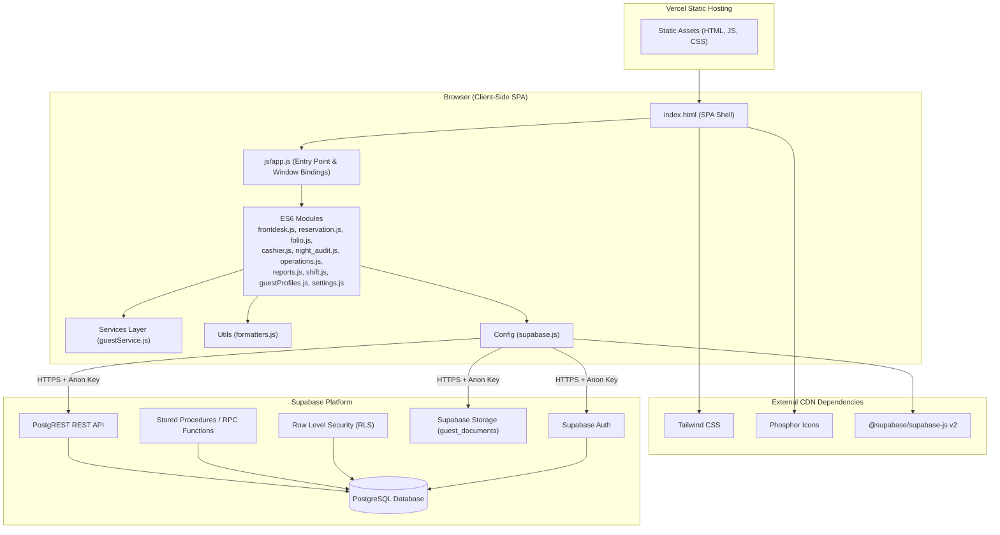
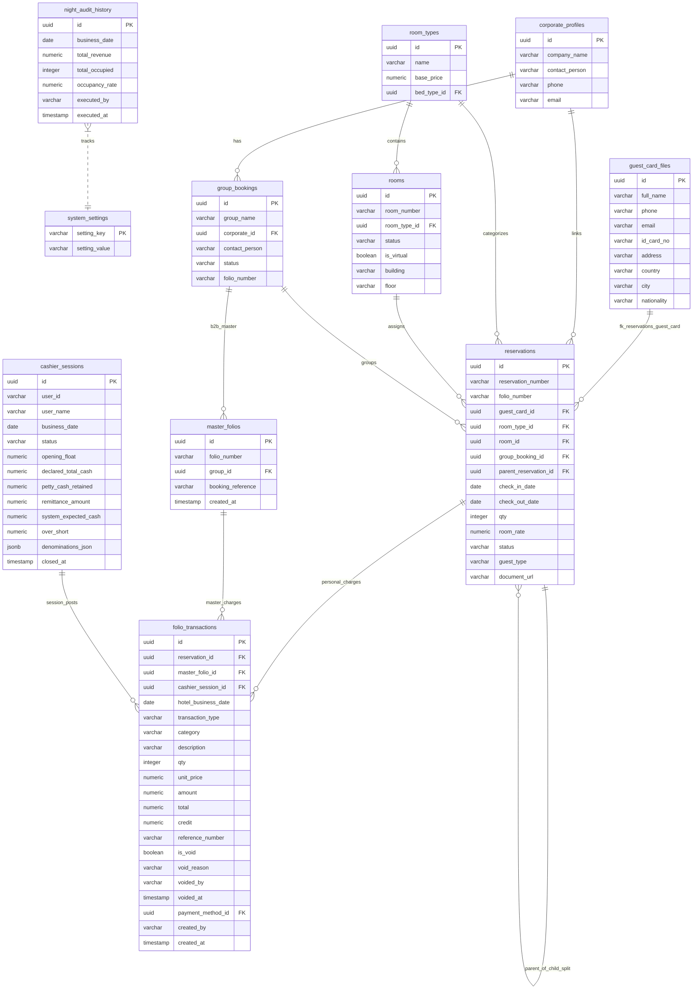
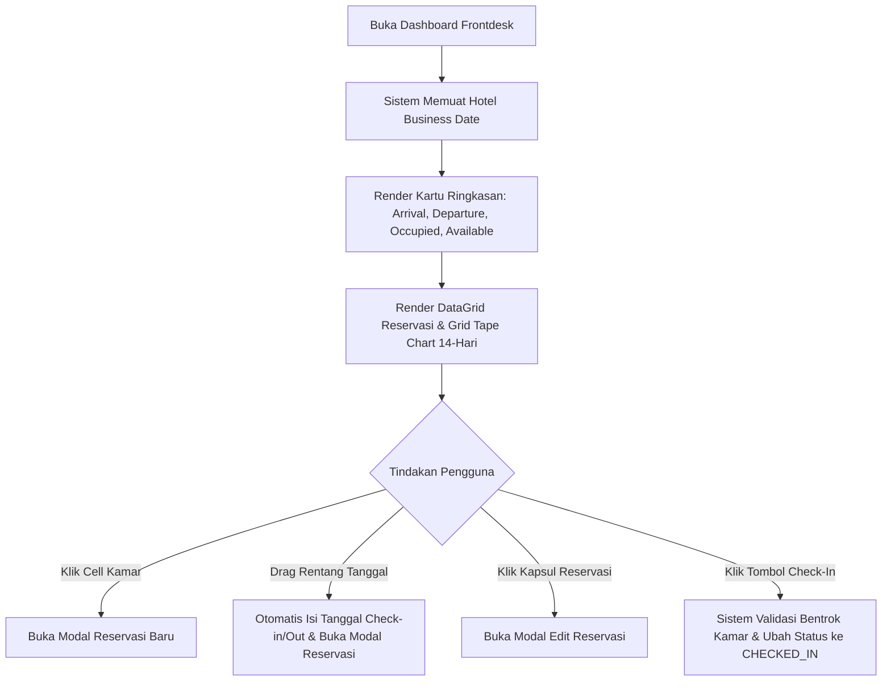
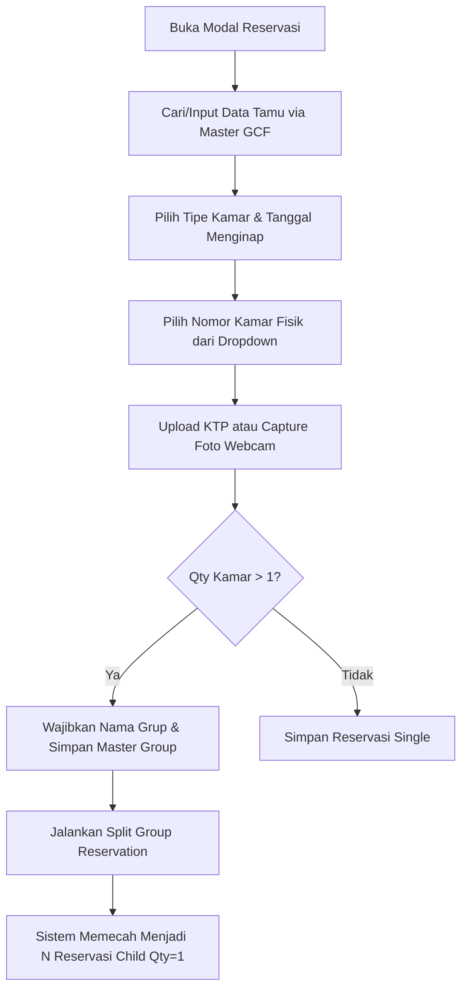
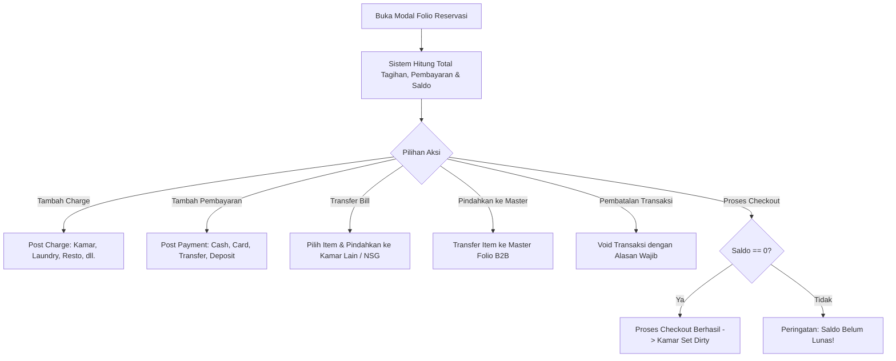
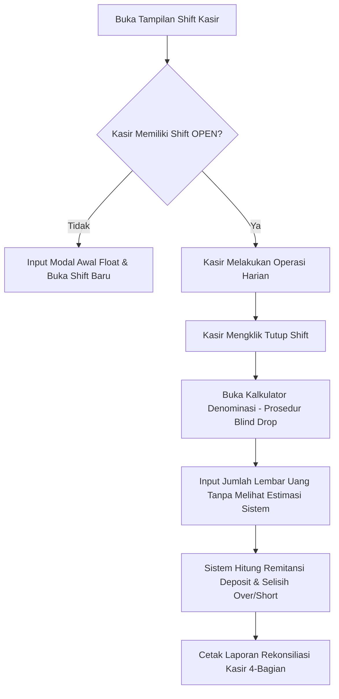
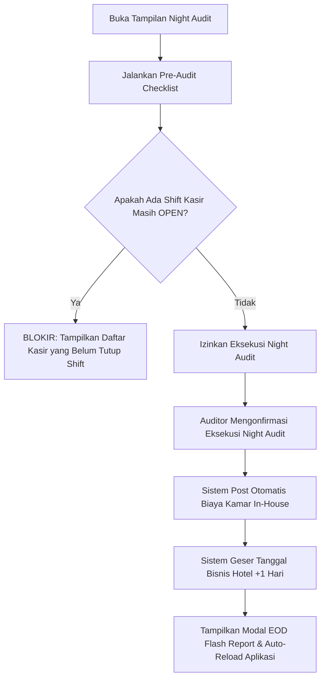

# Dokumentasi Komprehensif Hotel Property Management System (PMS)

Dokumen ini merupakan panduan komprehensif yang mengonsolidasikan spesifikasi teknis, arsitektur sistem, skema database, kontrak API RPC Supabase, serta panduan operasional pengguna (User Operational Manual) untuk **Hotel Property Management System (PMS)**.

---

## Daftar Isi

1. [Pendahuluan & Ringkasan Eksekutif](#1-pendahuluan--ringkasan-eksekutif)
2. [Arsitektur & Spesifikasi Teknis](#2-arsitektur--spesifikasi-teknis)
3. [Skema Database & Kamus Data](#3-skema-database--kamus-data)
4. [Spesifikasi Kontrak Stored Procedure / API RPC Supabase](#4-spesifikasi-kontrak-stored-procedure--api-rpc-supabase)
5. [Panduan Operasional Pengguna (User Manual)](#5-panduan-operasional-pengguna-user-manual)
6. [Aturan Bisnis & Batasan Operasional](#6-aturan-bisnis--batasan-operasional)
7. [Panduan Setup, Pengembangan Lokal & Deployment](#7-panduan-setup-pengembangan-lokal--deployment)
8. [Panduan Identifikasi & Penyelesaian Masalah (Troubleshooting)](#8-panduan-identifikasi--penyelesaian-masalah-troubleshooting)

---

## 1. Pendahuluan & Ringkasan Eksekutif

### 1.1 Gambaran Umum Sistem
Hotel Property Management System (PMS) adalah aplikasi berbasis web *Single Page Application* (SPA) yang dirancang untuk memodernisasi dan mengotomatiskan seluruh alur kerja operasional hotel. Aplikasi ini mencakup manajemen reservasi individu (B2C) maupun grup korporat (B2B), kalender ketersediaan kamar interaktif (*Tape Chart*), penagihan folio, manajemen shift kasir dengan protokol *Blind Drop*, pembaruan status *Housekeeping*, serta penutupan harian transaksi (*Night Audit*) untuk memajukan tanggal bisnis hotel.

### 1.2 Teknologi Utama
- **Frontend**: Pure Vanilla JavaScript (ES6 Modules) tanpa *build tool* (Zero-build architecture), Tailwind CSS (Utility-first styling), Phosphor Icons.
- **Backend / Database**: Supabase (PostgreSQL 15+ dengan PostgREST API, Stored Procedures / RPC, Row Level Security, dan Supabase Storage).
- **Hosting**: Vercel Static Hosting dengan integrasi CDN publik.

### 1.3 Daftar Istilah (Glosarium)

| Istilah | Definisi |
|---|---|
| **Allotment** | Blok kamar yang dialokasikan khusus untuk travel agent, perusahaan, atau grup. |
| **B2B (Business-to-Business)** | Akun korporat atau grup yang ditagihkan ke Master Folio. |
| **B2C (Business-to-Consumer)** | Reservasi individu yang ditagihkan langsung ke folio pribadi tamu. |
| **Blind Drop** | Prosedur penutupan shift kasir di mana kasir menginput jumlah fisik uang tanpa melihat estimasi sistem. |
| **Business Date** | Tanggal operasional hotel (`system_settings.current_hotel_date`) yang terpisah dari tanggal kalender lokal hingga Night Audit dijalankan. |
| **City Ledger / AR** | Piutang perusahaan/grup yang ditransfer ke Master Folio dan diselesaikan setelah checkout. |
| **EOD (End of Day)** | Proses Night Audit harian yang memposting biaya kamar, menggeser tanggal bisnis, dan mencetak laporan keuangan. |
| **FIT (Free Independent Traveler)** | Tamu perorangan/non-grup. |
| **Folio** | Buku besar transaksi finansial tamu (memuat tagihan, pembayaran, dan transfer). |
| **GCF (Guest Card File)** | Database master profil tamu yang memuat riwayat dan identitas tamu. |
| **Master Folio** | Akun penagihan konsolidasi untuk grup B2B atau korporasi. |
| **NSG (Non-Stay Guest)** | Tamu luar/walk-in yang menggunakan fasilitas hotel tanpa menginap. |
| **Night Audit** | Rekonsiliasi harian untuk memverifikasi transaksi, memposting biaya kamar, dan memperbarui tanggal bisnis. |
| **Opening Float** | Modal awal kasir saat membuka shift. |
| **Over/Short** | Selisih antara deklarasi uang fisik kasir dengan estimasi sistem (Positif = Surplus, Negatif = Defisit). |
| **Paymaster / Virtual Room** | Kamar virtual (awalan 'PM-') untuk konsolidasi tagihan grup B2B; tidak dihitung dalam okupansi fisik. |
| **Tape Chart** | Tampilan kalender interaktif grid 14-hari yang menampilkan ketersediaan dan reservasi kamar. |
| **Void** | Pembatalan transaksi terposting dengan *soft-delete* dan Jejak Audit (*Audit Trail*). |

---

## 2. Arsitektur & Spesifikasi Teknis

### 2.1 Arsitektur Tingkat Tinggi (High-Level Architecture)



### 2.2 Struktur Modular Frontend

Aplikasi disusun menggunakan arsitektur modular ES6 tanpa pembungkus (*bundler*):
- **`index.html`**: Antarmuka tunggal dengan wadah tampilan (*view container*) yang tersembunyi/tampil sesuai navigasi.
- **`js/app.js`**: Titik masuk (*entry point*) yang mengimpor seluruh fungsi modul dan mengikatnya (*binding*) ke objek `window` agar kompatibel dengan *inline handler* HTML (`onclick`, `onchange`).
- **`js/config/supabase.js`**: Inisialisasi klien Supabase JS SDK menggunakan `SUPABASE_URL` dan `SUPABASE_ANON_KEY`.
- **`js/modules/`**:
  - `frontdesk.js`: Pengelolaan Tape Chart, DataGrid kamar, dan Room Forecast.
  - `reservation.js`: Modal pembuatan/edit reservasi, upload/kamera ID dokumen tamu, dan split reservasi.
  - `group.js`: Pengelolaan alokasi kamar grup B2B dan *Rooming List*.
  - `folio.js`: Transaksi tagihan/pembayaran, transfer *bill*, dan cetak *invoice*.
  - `cashier.js` & `shift.js`: Buka/tutup shift kasir, kalkulator denominasi, logbook, dan laporan shift.
  - `night_audit.js`: Pengecekan pra-audit (*Pre-audit Check*), eksekusi EOD, dan EOD Flash Report.
  - `operations.js`: Housekeeping, Out of Order (OOO), pembatalan, dan profil korporat.
  - `reports.js`: Laporan pendapatan harian (*Daily Revenue Report / DRR*).
  - `guestProfiles.js` & `services/guestService.js`: Pencarian dan manajemen Master Guest Card File (GCF).
  - `settings.js`: Pengaturan kamar, kategori, harga, *tax & service*, *meal plan*, dan konfigurasi sistem.

---

## 3. Skema Database & Kamus Data

### 3.1 Diagram Entitas Relasi (ERD)



### 3.2 Kamus Data Tabel Utama

#### 1. `reservations`
Menyimpan data reservasi tamu individu dan grup.

| Nama Kolom | Tipe Data | Batasan | Keterangan |
| :--- | :--- | :--- | :--- |
| `id` | UUID | Primary Key | ID unik reservasi (`gen_random_uuid()`). |
| `reservation_number`| VARCHAR | Unique | Kode reservasi (contoh: `RES-20251005-001`). |
| `folio_number` | VARCHAR | Nullable | Nomor folio pribadi (contoh: `FOL-1001`). |
| `guest_card_id` | UUID | Foreign Key | Relasi ke `guest_card_files.id`. |
| `guest_name` | VARCHAR | Not Null | Nama utama tamu menginap. |
| `booker_name` | VARCHAR | Nullable | Nama pemesan/kontak. |
| `room_type_id` | UUID | Foreign Key | Relasi ke `room_types.id`. |
| `room_id` | UUID | Foreign Key | Relasi ke `rooms.id` (null jika belum di-assign). |
| `group_booking_id` | UUID | Foreign Key | Relasi ke `group_bookings.id` jika bagian dari grup. |
| `parent_reservation_id`| UUID | Foreign Key | Self-reference ke reservasi induk pada pemisahan split kamar. |
| `check_in_date` | DATE | Not Null | Tanggal masuk (check-in). |
| `check_out_date` | DATE | Not Null | Tanggal keluar (check-out). |
| `qty` | INTEGER | Default 1 | Jumlah kamar (di-split menjadi 1 untuk tiap kamar fisik). |
| `room_rate` | NUMERIC | Not Null | Harga sewa kamar per malam. |
| `status` | VARCHAR | Not Null | Status: `'GUARANTEED'`, `'6PM_HOLD'`, `'ORAL_CONFIRM'`, `'TENTATIVE'`, `'CHECKED_IN'`, `'CHECKED_OUT'`, `'CANCELLED'`. |
| `guest_type` | VARCHAR | Default 'FIT'| Jenis tamu: `'FIT'`, `'Group'`, `'Non-Staying Guest'`. |
| `document_url` | TEXT | Nullable | URL berkas KTP/Paspor di Supabase Storage. |

#### 2. `folio_transactions`
Buku besar transaksi keuangan mencatat charge, payment, deposit, dan transfer.

| Nama Kolom | Tipe Data | Batasan | Keterangan |
| :--- | :--- | :--- | :--- |
| `id` | UUID | Primary Key | ID unik transaksi. |
| `reservation_id` | UUID | Foreign Key | Relasi ke `reservations.id`. |
| `master_folio_id` | UUID | Foreign Key | Relasi ke `master_folios.id` untuk tagihan grup/korporasi. |
| `cashier_session_id`| UUID | Foreign Key | Relasi ke `cashier_sessions.id` (shift kasir penanggung jawab). |
| `hotel_business_date`| DATE | Not Null | Tanggal bisnis hotel saat transaksi dicatat. |
| `transaction_type` | VARCHAR | Not Null | Tipe: `'CHARGE'`, `'PAYMENT'`, `'DEPOSIT'`, `'TRANSFER'`. |
| `category` | VARCHAR | Nullable | Kategori: `'ROOM_CHARGE'`, `'CASH'`, `'CREDIT_CARD'`, `'BANK_TRANSFER'`, `'EXTRA_CHARGE'`. |
| `description` | TEXT | Not Null | Rincian deskripsi transaksi. |
| `qty` | INTEGER | Default 1 | Jumlah item. |
| `unit_price` | NUMERIC | Nullable | Harga satuan. |
| `amount` | NUMERIC | Not Null | Total nilai transaksi (`qty * unit_price`). |
| `is_void` | BOOLEAN | Default false| Indikator jika transaksi dibatalkan (soft delete). |
| `void_reason` | TEXT | Nullable | Alasan pembatalan transaksi (wajib diisi). |
| `voided_by` | VARCHAR | Nullable | Nama pengguna yang membatalkan. |
| `voided_at` | TIMESTAMP | Nullable | Waktu pembatalan. |

#### 3. `cashier_sessions`
Mencatat shift kerja kasir, modal awal (*opening float*), penutupan *blind drop*, dan selisih kas.

| Nama Kolom | Tipe Data | Batasan | Keterangan |
| :--- | :--- | :--- | :--- |
| `id` | UUID | Primary Key | ID unik shift kasir. |
| `user_name` | VARCHAR | Not Null | Nama kasir penerima shift. |
| `business_date` | DATE | Not Null | Tanggal bisnis hotel. |
| `status` | VARCHAR | Not Null | Status: `'OPEN'` atau `'CLOSED'`. |
| `opening_float` | NUMERIC | Default 0 | Modal kas awal kasir. |
| `declared_total_cash`| NUMERIC | Nullable | Total kas fisik hasil hitungan kasir (Blind Drop). |
| `remittance_amount` | NUMERIC | Nullable | Uang yang disetorkan ke bank (`declared - petty_cash_retained`). |
| `system_expected_cash`| NUMERIC| Nullable | Estimasi kas menurut sistem. |
| `over_short` | NUMERIC | Nullable | Selisih kas (`declared - expected`). |
| `denominations_json`| JSONB | Nullable | Rincian jumlah lembar/koin uang kasir. |

### 3.3 Indeks Optimalisasi Database
Untuk menjaga kecepatan respon query saat volume data meningkat, indeks berikut diterapkan pada PostgreSQL:
1. `idx_folio_tx_hotel_bdate`: Mempercepat agregat pendapatan harian dan EOD Flash Report.
2. `idx_folio_tx_session_created`: Mempercepat penarikan transaksi per-shift kasir.
3. `idx_cashier_sessions_status_bdate`: Mempercepat pengecekan pra-audit shift terbuka (`OPEN`).
4. `idx_reservations_dates_status`: Mempercepat pendorongan data Tape Chart dan Room Forecast.
5. `idx_reservations_room_dates`: Mempercepat fungsi deteksi bentrok kamar (`checkRoomConflict`).

---

## 4. Spesifikasi Kontrak Stored Procedure / API RPC Supabase

Seluruh logika bisnis sensitif dieksekusi secara terpusat melalui *Stored Procedures* (RPC) di Supabase.

### 4.1 Katalog Fungsi RPC

#### 1. `fn_pre_night_audit_check()`
- **Tujuan**: Validasi kesiapan sistem sebelum menjalankan Night Audit.
- **Output**: `TABLE(can_proceed BOOLEAN, reason TEXT, open_shifts INTEGER, pending_arrivals INTEGER, pending_departures INTEGER)`.
- **Aturan**: Blokir penuh jika terdapat `cashier_sessions` bersatus `'OPEN'`.

#### 2. `fn_execute_night_audit(p_user_name VARCHAR)`
- **Tujuan**: Melakukan penutupan harian EOD.
- **Langkah Operasional**:
  1. Memposting biaya kamar otomatis untuk seluruh tamu yang menginap (`CHECKED_IN`).
  2. Menggeser `system_settings.current_hotel_date` sebanyak +1 hari.
  3. Mencatat ringkasan ke `night_audit_history`.
- **Output**: `JSONB` `{ success: true, new_business_date: "YYYY-MM-DD", total_revenue: 15000000, total_occupied: 35 }`.

#### 3. `rpc_open_cashier_shift(p_cashier_name VARCHAR, p_shift_name VARCHAR, p_opening_float NUMERIC)`
- **Tujuan**: Membuka shift kasir baru dengan menginput modal awal.
- **Output**: Metadata shift baru berstatus `'OPEN'`.

#### 4. `rpc_close_cashier_shift(p_shift_id UUID, p_actual_cash NUMERIC, p_cash_drop NUMERIC, p_notes TEXT)`
- **Tujuan**: Menutup shift kasir dengan prosedur *Blind Drop*.
- **Output**: `JSONB` perhitungan `over_short` dan `system_expected_cash`.

#### 5. `rpc_get_available_physical_rooms(p_room_type_id UUID, p_check_in DATE, p_check_out DATE, p_current_res_id UUID)`
- **Tujuan**: Mengambil daftar kamar fisik yang tersedia tanpa bentrok reservasi lain pada rentang tanggal terkait.

#### 6. `rpc_post_folio_transaction(...)`
- **Tujuan**: Memposting tagihan (*charge*) atau pembayaran (*payment*) ke folio pribadi/master. Menautkan secara otomatis `hotel_business_date` dan `cashier_session_id`.

#### 7. `rpc_transfer_folio_transaction(p_transaction_ids UUID[], p_target_reservation_id UUID, p_target_master_folio_id UUID)`
- **Tujuan**: Memindahkan item transaksi dari satu folio ke folio lain atau Master Folio dengan catatan *reversal entry*.

#### 8. `rpc_void_folio_transaction(p_transaction_id UUID, p_void_reason TEXT)`
- **Tujuan**: Membatalkan transaksi secara *soft delete* (`is_void = true`) disertai alasan wajib dan nama pengguna.

#### 9. `rpc_process_checkout(p_reservation_id UUID)`
- **Tujuan**: Proses checkout tamu. Menvalidasi saldo nol (`balance == 0`), mengubah status reservasi menjadi `'CHECKED_OUT'`, dan mengubah status kamar fisik menjadi `'Dirty'`.

---

## 5. Panduan Operasional Pengguna (User Manual)

### 5.1 Peran Pengguna & Hak Akses

1. **Front Desk Agent / Kasir**:
   - Melihat Dashboard, Tape Chart, dan Room Forecast.
   - Membuat/mengedit reservasi individu, mengunggah ID tamu, atau mengambil foto lewat webcam.
   - Membuka & menutup shift kasir pribadi.
   - Memposting tagihan, pembayaran, dan transfer bill folio.
   - Melakukan Check-In dan Check-Out tamu.
   - Memperbarui status Housekeeping.

2. **Night Auditor / Finance Officer**:
   - Memiliki semua hak akses Front Desk.
   - Menjalankan Pre-Audit Check dan eksekusi Night Audit.
   - Mencetak EOD Flash Report dan Laporan Rekonsiliasi Kasir.
   - Mengelola pemrosesan deposit dan pembatalan reservasi.

3. **System Administrator / Hotel Manager**:
   - Memiliki semua hak akses Night Auditor.
   - Mengonfigurasi data master: Tipe Kamar, Kamar Fisik, Harga, Tax & Service, Meal Plan, Rate Plan, dan Profil Korporat.
   - Menggabungkan (*merge*) profil tamu ganda di GCF Master.

---

### 5.2 Alur Kerja Modul Utama

#### Modul 1: Frontdesk Dashboard & Tape Chart



- **Fitur Utama**:
  - **Tape Chart Grid 14-Hari**: Menampilkan baris kamar fisik dan kapsul reservasi berwarna sesuai status.
  - **Drag-to-Select**: Geser dan tahan mouse pada baris kamar untuk memilih rentang tanggal masuk/keluar secara langsung.
  - **Laci Kamar Unassigned**: Reservasi yang belum mendapat alokasi nomor kamar fisik akan masuk ke laci bawah untuk di-assign secara *drag-and-drop* atau manual.

---

#### Modul 2: Pemesanan Kamar (Reservation) & Group Booking Split



- **Prosedur Upload Dokumen / Webcam**:
  - Pengguna dapat mengunggah foto KTP/Paspor. Sistem di browser akan mengompres foto secara otomatis (JPEG quality 0.7, lebar maksimum 800px) sebelum diunggah ke Supabase Storage `guest_documents`.
  - Alternatif kamera webcam langsung tersedia melalui tombol "Ambil Foto ID".

---

#### Modul 3: Manajemen Folio & Akuntansi Tamu



- **Fitur Master Folio B2B**:
  - Tagihan tamu grup dapat dipindahkan ke Master Folio (`master_folios`).
  - Item yang telah dipindah diberi lencana (*badge*) khusus "Transferred to Master" dan dikeluarkan dari perhitungan saldo pribadi tamu.

---

#### Modul 4: Manajemen Shift Kasir (Cashier Shift)



- **Laporan 4-Bagian Rekonsiliasi**:
  1. *Cash Movement* (Modal Awal, Penerimaan Kas, Pengeluaran Kas, Net Kas).
  2. *Non-Cash Payments* (EDC Kredit/Debit, Transfer Bank).
  3. *City Ledger / AR Transfers* (Transfer ke Master Folio).
  4. *Voided Transactions* (Daftar transaksi yang dibatalkan).

---

#### Modul 5: Night Audit & Penutupan Harian (EOD)



---

## 6. Aturan Bisnis & Batasan Operasional

1. **Kedaulatan Tanggal Bisnis (Business Date Sovereignty)**:
   Seluruh transaksi finansial, laporan pendapatan harian, dan pencatatan shift kasir mengacu pada `current_hotel_date` di `system_settings`, bukan pada jam/tanggal komputer lokal browser.
2. **Syarat Pelunasan Checkout**:
   Tamu tidak dapat di-checkout-kan (`CHECKED_OUT`) jika saldo akhir folio belum bernilai `0`.
3. **Penguncian Stok Kamar (Room Inventory Lock)**:
   Reservasi dengan status `GUARANTEED`, `6PM_HOLD`, `ORAL_CONFIRM`, dan `CHECKED_IN` mengunci ketersediaan kamar. Status `TENTATIVE` tidak mengunci ketersediaan.
4. **Prinsip Non-Destruktif Void**:
   Transaksi finansial yang sudah terposting tidak boleh dihapus secara fisik (*hard delete*). Pembatalan menggunakan *soft delete* (`is_void = true`) dengan mencatat alasan wajib, waktu, dan nama pengguna.
5. **Proteksi Bentrok Kamar Fisik**:
   Sistem secara otomatis mencegah penetapan nomor kamar fisik yang sama pada reservasi dengan tanggal menginap yang tumpang tindih (*overlapping*).

---

## 7. Panduan Setup, Pengembangan Lokal & Deployment

### 7.1 Prasyarat System
- Web Server Statis (Python HTTP Server, Live Server, Nginx, atau Vercel).
- Akun dan Proyek Supabase aktif.

### 7.2 Langkah Pengembangan Lokal

1. Kloning repositori proyek ke komputer lokal.
2. Buka berkas `js/config/supabase.js`.
3. Pastikan konfigurasi `SUPABASE_URL` dan `SUPABASE_ANON_KEY` sudah sesuai:
   ```javascript
   export const SUPABASE_URL = 'https://YOUR_PROJECT_ID.supabase.co';
   export const SUPABASE_ANON_KEY = 'YOUR_ANON_PUBLISHABLE_KEY';
   export const supabaseClient = supabase.createClient(SUPABASE_URL, SUPABASE_ANON_KEY);
   ```
4. Jalankan *HTTP Web Server* lokal (Jangan membuka `index.html` via `file://` karena modul ES6 membutuhkan konteks HTTP/HTTPS):
   ```bash
   # Menggunakan Python 3
   python3 -m http.server 8000

   # Atau menggunakan Node.js serve
   npx serve .
   ```
5. Buka `http://localhost:8000` di peramban (Google Chrome direkomendasikan).

### 7.3 Deployment ke Vercel

1. Hubungkan repositori GitHub/GitLab ke Vercel.
2. Setel *Build Command* menjadi kosong (karena aplikasi ini *Zero-build SPA*).
3. Setel *Output Directory* menjadi root `./`.
4. Tambahkan Environment Variables `SUPABASE_URL` dan `SUPABASE_ANON_KEY` pada pengaturan Vercel jika diperlukan.
5. Jalankan Deploy.

---

## 8. Panduan Identifikasi & Penyelesaian Masalah (Troubleshooting)

### 8.1 Masalah Umum & Solusinya

#### 1. Night Audit Terblokir: "Open Cashier Shifts Exist"
- **Penyebab**: Terdapat shift kasir yang masih berstatus `'OPEN'` pada tanggal bisnis saat ini.
- **Solusi**:
  1. Identifikasi kasir yang belum menutup shift dari pesan peringatan.
  2. Minta kasir terkait untuk melakukan penutupan shift (Blind Drop).
  3. Jika kasir berhalangan, Administrator dapat menutup shift secara manual melalui query SQL:
     ```sql
     UPDATE cashier_sessions
     SET status = 'CLOSED', closed_at = NOW(),
         declared_total_cash = system_expected_cash,
         over_short = 0,
         denominations_json = '{"admin_override": true}'::jsonb
     WHERE id = 'ID_SHIFT_KASIR';
     ```

#### 2. Pesan Kesalahan Bentrok Kamar Saat Check-In
- **Penyebab**: Kamar fisik telah dialokasikan ke reservasi aktif lain pada rentang tanggal yang bersinggungan.
- **Solusi**: Ubah alokasi nomor kamar pada reservasi baru ke kamar lain yang masih kosong melalui modal edit reservasi.

#### 3. Kesalahan Foreign Key Saat Menyimpan Reservasi
- **Penyebab**: Nilai string kosong `""` atau `0` terkirim untuk `guest_card_id` alih-alih `null`.
- **Solusi**: Sistem di `js/modules/reservation.js` telah memiliki fungsi konversi otomatis dari nilai kosong menjadi `null` sebelum dikirim ke database.

#### 4. Selisih Kasir (Over/Short) Sangat Besar
- **Penyebab**: Terdapat transaksi folio yang terposting tanpa menautkan `cashier_session_id` aktif.
- **Solusi**: Pastikan kasir telah membuka shift secara resmi sebelum memposting transaksi transaksi keuangan.

#### 5. Gambar KTP/Paspor Gagal Terunggah
- **Penyebab**: Koneksi terputus atau batas RLS bucket Supabase Storage `guest_documents` menolak akses.
- **Solusi**: Periksa kebijakan RLS pada bucket `guest_documents` di dashboard Supabase dan pastikan opsi kompresi client-side aktif.

---
*Dokumen ini disusun sebagai panduan standar operasional dan teknis pengembangan sistem Hotel Property Management System (PMS).*
